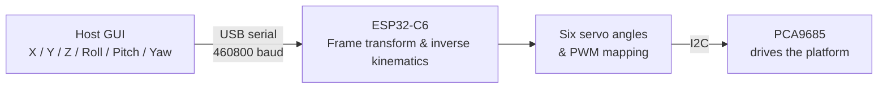

<div align="center">

# Mini-Stewart-Platform

[繁體中文](README.zh-TW.md) | **English**

**A miniature 6-DOF Stewart platform｜ESP32-C6 control with a Python host GUI**

[](firmware/ESP32C6_PCA/)
[](firmware/ESP32C6_PCA/ESP32C6_PCA.ino)
[](stewart_control_gui.py)
[](firmware/ESP32C6_PCA/)
[](LICENSE)
[](https://zhang-xichang.github.io/Mini-Stewart-Platform/)
[](https://zhang-xichang.github.io/Mini-Stewart-Platform/slides/)

A Python host GUI sets the platform's position and orientation, the ESP32-C6 solves the inverse kinematics,<br>
and a PCA9685 drives the six servo motors.


[Demo](#demo) · [Quick start](#quick-start) · [Hardware setup](#flashing-and-hardware-setup) · [Protocol](#communication-protocol) · [3D models](#3d-models) · [Testing & validation](docs/VALIDATION.md) · [Slides](https://zhang-xichang.github.io/Mini-Stewart-Platform/slides/) ([PDF](presentations/stewart-platform.pdf))

</div>

> [!NOTE]
> **Status: physically assembled and tested in operation.** This repository provides the host software, ESP32 firmware and mechanical models, covering the miniaturized mechanism, control system, host interface and hardware testing, as a reference for learning and building.

## Demo

| Second-generation demo | First-generation demo |
| :---: | :---: |
| [▶ v2-demo.mp4](docs/videos/v2-demo.mp4) | [▶ v1-demo.mp4](docs/videos/v1-demo.mp4) |

The videos are MP4 files; click to play them on GitHub or download.

## Development history and contributions

<table>
  <tr>
    <th align="center">First generation</th>
    <th align="center">Second generation</th>
  </tr>
  <tr>
    <td align="center"></td>
    <td align="center"></td>
  </tr>
</table>

| Area | Work |
| --- | --- |
| **Mechanism** | Scaled down the platform; STL, STEP and SolidWorks design files are included. |
| **Control system** | ESP32 / PCA9685 control; later versions moved the inverse kinematics onto the ESP32. |
| **Host GUI** | Six-axis manual control, per-axis sine-wave settings and command waveform display. |
| **Assembly & testing** | Completed physical assembly plus motion and load tests; detailed test conditions and measurements are still to be added. |

<table>
  <tr>
    <th align="center">Second-generation CAD</th>
    <th align="center">Load test</th>
    <th align="center">Running</th>
  </tr>
  <tr>
    <td align="center"></td>
    <td align="center"></td>
    <td align="center"></td>
  </tr>
</table>

> [!IMPORTANT]
> The load-test photo only documents a loaded test scenario. Load weight, duration, motion amplitude and positioning error have not been recorded in this project, so no maximum payload is claimed from it.

## System architecture

In the main version, the host sends pose commands and the ESP32 handles inverse kinematics and servo output.



| File | Purpose |
| --- | --- |
| [`stewart_control_gui.py`](stewart_control_gui.py) | New Python host GUI; sends poses |
| [`ESP32C6_PCA.ino`](firmware/ESP32C6_PCA/ESP32C6_PCA.ino) | Receives poses and drives the PCA9685 |
| [`stewart_kinematics.h`](firmware/ESP32C6_PCA/stewart_kinematics.h) | Geometry parameters and inverse kinematics on the ESP32; must sit in the same folder as the .ino |

<details>
<summary><b>Repository layout</b></summary>

```text
Mini-Stewart-Platform/
├── stewart_control_gui.py        # Main host GUI
├── requirements.txt              # Python dependencies
├── firmware/ESP32C6_PCA/
│   ├── ESP32C6_PCA.ino           # Main firmware
│   └── stewart_kinematics.h      # ESP32 inverse kinematics & geometry
├── GIF/Logo.gif                  # GUI logo
├── docs/assets/img/              # Hardware and model photos (compressed JPG)
├── docs/videos/                  # Demo MP4s
├── models/                       # STL, STEP, SolidWorks
├── legacy/binary_pca9685/        # Legacy / binary-compatible interface
├── README.md                     # English README
├── README.zh-TW.md               # 繁體中文 README
├── LICENSE
└── .gitignore
```

The main version uses the host GUI in the root and `firmware/`; `legacy/` keeps older code for reference.

</details>

## Quick start

### Install the host GUI

Open PowerShell in the repository root:

```powershell
python -m venv .venv
.\.venv\Scripts\python.exe -m pip install -r requirements.txt
.\.venv\Scripts\python.exe stewart_control_gui.py
```

| Package | Purpose |
| --- | --- |
| `pyserial` | Serial communication |
| `matplotlib` | Waveform display |
| `Pillow` | Images |
| `numpy` | Retained legacy visualization |

A Tkinter-capable desktop environment is required; package versions are not pinned yet.

Select the ESP32's COM port and connect. `GIF/Logo.gif` is the GUI logo; you can drop other GIFs into `GIF/` as optional animations, and the program still runs without them.

> [!TIP]
> Don't keep the same COM port open in the Arduino Serial Monitor, or the host GUI won't be able to connect.

### Flashing and hardware setup

1. In the Arduino IDE, install the Espressif ESP32 board package that supports your ESP32-C6 board.
2. Install `Adafruit PWM Servo Driver Library` and its dependencies (including Adafruit BusIO).
3. Open `firmware/ESP32C6_PCA/ESP32C6_PCA.ino`; `stewart_kinematics.h` must be in the same folder.
4. Check the parameters below against your actual mechanism, then compile and upload.

<table>
<tr><th>Hardware & communication</th><th>Geometry & calibration</th></tr>
<tr valign="top"><td>

| Item | Setting |
| --- | --- |
| SDA / SCL | GPIO22 / GPIO23 |
| PCA9685 address | `0x40` |
| PCA9685 channels | CH0–CH5 |
| Baud rate | 460800 baud |
| Servo PWM frequency | **330 Hz** |
| Communication timeout | 1 s |

</td><td>

| Item | Setting |
| --- | --- |
| Base / platform radius | 68 / 68 mm |
| Horn / rod length | 24 / 99 mm |
| Neutral platform height | **96.04 mm** |
| Pose units | Translation mm, rotation degrees |
| Reversed channels | CH0, CH2, CH4 |
| Channel offsets (µs) | 80, 100, 100, 0, 100, 50 |

</td></tr>
</table>

- The servo PWM frequency must match your servos' specification.
- Communication timeout: if no valid pose arrives within 1 s, the firmware returns the platform to center.

> [!WARNING]
> Power the servos through PCA9685 V+ according to their specification, and the ESP32 and PCA9685 must **share a common ground**. Logic VCC and the I2C pull-ups must match the ESP32's **3.3 V** logic.
> The PCA output calibration in the firmware is specific to the original build and should not be treated as measurements for other hardware.

## Communication protocol

Main-version format (each packet ends with a newline):

```text
$P,x,y,z,roll,pitch,yaw,checksum
```

| Command | Description |
| --- | --- |
| `$P,...` | Pose packet; values formatted to two decimal places |
| `$V,0` | Disable verbose responses |
| `$V,1` | Enable verbose responses |

**Checksum**: multiply each value by 10, truncate each to an integer, sum them, and keep the low 8 bits. The firmware uses single-precision floats while the host uses Python floats, so the checksum still needs testing at decimal boundaries.

> [!CAUTION]
> - The GUI waveforms show **commanded values**, not the platform's actual pose measured by sensors.
> - "Emergency stop" stops the test and sends a return-to-center command; it **does not cut motor power**.
> - After sending a single manual command without continuous updates, the firmware may return to center after 1 s.

## Legacy and compatible versions

| Version | Host entry point | Matching firmware | Protocol |
| --- | --- | --- | --- |
| **Main** | `stewart_control_gui.py` | `firmware/ESP32C6_PCA/ESP32C6_PCA.ino` | 460800 baud, `$P` pose packets |
| Legacy / compatible | `legacy/binary_pca9685/6dof_visualizer.py`<br>or `stewart_control_gui.py` in the same folder | `legacy/binary_pca9685/esp32c6_pca9685_receiver/` | 115200 baud, 12-byte angle packets |

[legacy/binary_pca9685](legacy/binary_pca9685/README.md) provides 3D visualization and a PC-side inverse-kinematics compatible interface.

> [!WARNING]
> The host programs in the two folders use different protocols. Pair each with the firmware in its own folder and **do not mix them with the main firmware**.

## 3D models

See the [model notes](models/README.md).

| Format | Contents |
| --- | --- |
| [STL](models/stl/) | Printable parts |
| [STEP](models/step/) | Assembly exchange format |
| [SolidWorks](models/solidworks/) | Assembly and native part files |

Keep the part files' relative locations when opening the SolidWorks assembly; check dimensions, fit clearances and material settings before printing.

## Testing and validation

See [Testing & validation](docs/VALIDATION.md) (Traditional Chinese) for hardware demos, software test coverage and how to reproduce them.

## AI collaboration

This project was developed with help from AI tools:

- **[OpenAI Codex (@codex)](https://github.com/codex)**: documentation, code review and parts of the code.
- **Claude Code (Anthropic)**: built the [GitHub Pages showcase site](https://zhang-xichang.github.io/Mini-Stewart-Platform/), the 3D simulation and architecture diagrams, and helped find and fix an error in the inverse-kinematics rotation matrix (see [Testing & validation](docs/VALIDATION.md)).

The mechanism miniaturization, hardware assembly and physical testing were done by the project author. The hardware photos and videos are real records, not AI-generated. Software checks run by AI are not a substitute for hardware validation.

## Credits and license

This project builds on [knaufinator/6DOF-Rotary-Stewart-Motion-Simulator](https://github.com/knaufinator/6DOF-Rotary-Stewart-Motion-Simulator), miniaturizing it and implementing a new control system. The original [MIT License](LICENSE) and Chris Knauf's attribution are retained.

For the mathematical derivation, see Robert Eisele (2019), [Inverse Kinematics of a Stewart Platform](https://raw.org/research/inverse-kinematics-of-a-stewart-platform/).
