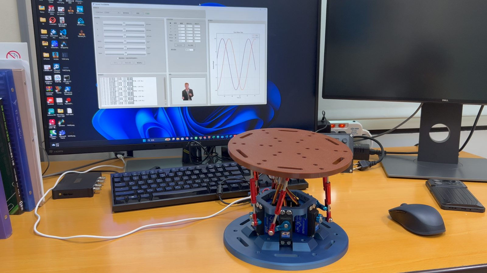
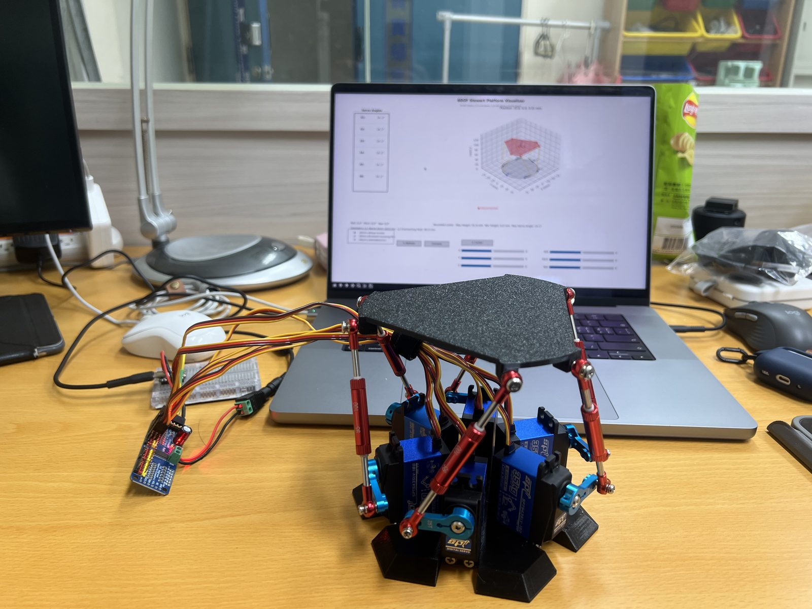
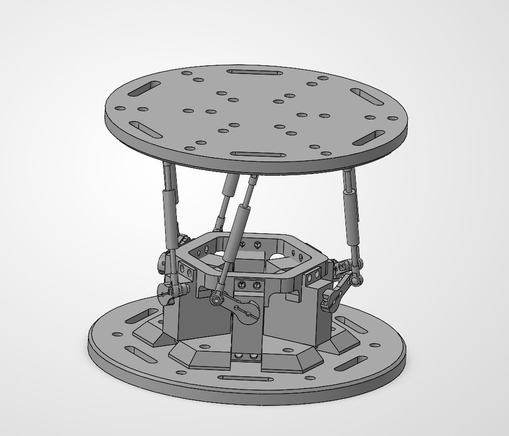

<div align="center">

# Mini-Stewart-Platform

**繁體中文** | [English](README.md)

**小型六自由度 Stewart 平台｜ESP32-C6 控制與 Python 上位機**

[](firmware/ESP32C6_PCA/)
[](firmware/ESP32C6_PCA/ESP32C6_PCA.ino)
[](stewart_control_gui.py)
[](firmware/ESP32C6_PCA/)
[](LICENSE)
[](https://zhang-xichang.github.io/Mini-Stewart-Platform/)
[](https://zhang-xichang.github.io/Mini-Stewart-Platform/slides/)

以 Python 上位機設定平台位置與姿態，由 ESP32-C6 計算逆運動學，<br>
再透過 PCA9685 控制六組伺服馬達。



[運行展示](#運行展示) · [快速開始](#快速開始) · [硬體設定](#燒錄與硬體設定) · [通訊協定](#通訊協定) · [3D 模型](#3d-模型) · [測試與驗證](docs/VALIDATION.md) · [技術簡報](https://zhang-xichang.github.io/Mini-Stewart-Platform/slides/)（[PDF](presentations/stewart-platform.pdf)）

</div>

> [!NOTE]
> **目前狀態：已完成實體組裝與運行測試。** 本專案提供上位機程式、ESP32 韌體與機構模型，涵蓋小型化機構設計、控制系統、上位機介面與實機測試，供學習與實作參考。

## 運行展示

| 二代運行影片 | 初代運行影片 |
| :---: | :---: |
| [▶ v2-demo.mp4](docs/videos/v2-demo.mp4) | [▶ v1-demo.mp4](docs/videos/v1-demo.mp4) |

影片為 MP4 格式，點擊後可於 GitHub 播放或下載。

## 開發歷程與個人貢獻

<table>
  <tr>
    <th align="center">初代實機</th>
    <th align="center">二代實機</th>
  </tr>
  <tr>
    <td align="center"></td>
    <td align="center"></td>
  </tr>
</table>

| 項目 | 內容 |
| --- | --- |
| **機構調整** | 縮小平台機構，提供 STL、STEP 與 SolidWorks 設計檔。 |
| **控制系統** | ESP32／PCA9685 控制實作，後續版本將逆運動學移至 ESP32。 |
| **上位機修改** | 提供六軸手動操作、各軸正弦波設定與命令波形顯示。 |
| **組裝與測試** | 完成實體組裝及運動、負載測試；詳細測試條件與量測數據待補充。 |

<table>
  <tr>
    <th align="center">二代模型</th>
    <th align="center">負載測試</th>
    <th align="center">運行照片</th>
  </tr>
  <tr>
    <td align="center"></td>
    <td align="center"></td>
    <td align="center"></td>
  </tr>
</table>

> [!IMPORTANT]
> 負載測試照片僅記錄放置負載的測試情境。負載重量、持續時間、運動幅度及定位誤差尚未記錄於本專案，因此不據此宣稱最大承載量。

## 系統架構

主版本由上位機傳送姿態命令，ESP32 負責逆運動學與伺服輸出。


| 檔案 | 用途 |
| --- | --- |
| [`stewart_control_gui.py`](stewart_control_gui.py) | 新版 Python 上位機，傳送姿態 |
| [`ESP32C6_PCA.ino`](firmware/ESP32C6_PCA/ESP32C6_PCA.ino) | 接收姿態、驅動 PCA9685 |
| [`stewart_kinematics.h`](firmware/ESP32C6_PCA/stewart_kinematics.h) | ESP32 端幾何參數與逆運動學；須與 ino 放在同一資料夾 |

<details>
<summary><b>專案目錄結構</b></summary>

```text
Mini-Stewart-Platform/
├── stewart_control_gui.py        # 主版本上位機
├── requirements.txt              # Python 相依套件
├── firmware/ESP32C6_PCA/
│   ├── ESP32C6_PCA.ino           # 主版本韌體
│   └── stewart_kinematics.h      # ESP32 逆運動學與幾何參數
├── GIF/Logo.gif                  # 介面標誌
├── docs/assets/img/              # 實機與模型照片（已壓縮 JPG）
├── docs/videos/                  # 示範 MP4
├── models/                       # STL、STEP、SolidWorks
├── legacy/binary_pca9685/        # 舊版與二進位相容介面
├── README.md                     # 英文說明
├── README.zh-TW.md               # 繁體中文說明（本檔）
├── LICENSE
└── .gitignore
```

主版本使用根目錄的上位機與 `firmware/`；`legacy/` 提供舊版程式作為參考。

</details>

## 快速開始

### 安裝上位機

在專案根目錄開啟 PowerShell：

```powershell
python -m venv .venv
.\.venv\Scripts\python.exe -m pip install -r requirements.txt
.\.venv\Scripts\python.exe stewart_control_gui.py
```

| 套件 | 用途 |
| --- | --- |
| `pyserial` | 串列通訊 |
| `matplotlib` | 波形顯示 |
| `Pillow` | 圖片 |
| `numpy` | 保留的舊版視覺化 |

需具備 Tkinter 圖形環境；套件版本尚未鎖定。

選擇 ESP32 的 COM 埠並連線即可操作。`GIF/Logo.gif` 用於介面標誌；可在 `GIF/` 放入其他 GIF 作為選用動畫，缺少 GIF 時程式仍可執行。

> [!TIP]
> 同一 COM 埠勿同時由 Arduino 串列監控視窗占用，否則上位機無法連線。

### 燒錄與硬體設定

1. 在 Arduino IDE 安裝支援實際 ESP32-C6 開發板的 Espressif ESP32 套件。
2. 安裝 `Adafruit PWM Servo Driver Library` 及其相依套件（包含 Adafruit BusIO）。
3. 開啟 `firmware/ESP32C6_PCA/ESP32C6_PCA.ino`；同目錄必須包含 `stewart_kinematics.h`。
4. 核對下列參數與實際機構後，再編譯及上傳。

<table>
<tr><th>硬體與通訊</th><th>機構幾何與校正</th></tr>
<tr valign="top"><td>

| 項目 | 設定 |
| --- | --- |
| SDA / SCL | GPIO22 / GPIO23 |
| PCA9685 位址 | `0x40` |
| PCA9685 通道 | CH0～CH5 |
| 串列速率 | 460800 baud |
| 伺服 PWM 頻率 | **330 Hz** |
| 通訊逾時 | 1 秒 |

</td><td>

| 項目 | 設定 |
| --- | --- |
| 底座／平台半徑 | 68 / 68 mm |
| 搖臂／連桿長度 | 24 / 99 mm |
| 中立平台高度 | **96.04 mm** |
| 姿態單位 | 平移 mm、旋轉 degree |
| 通道反轉 | CH0、CH2、CH4 |
| 通道偏移 (µs) | 80、100、100、0、100、50 |

</td></tr>
</table>

- 伺服 PWM 頻率須符合實際伺服規格。
- 通訊逾時：1 秒未收到有效姿態，韌體會觸發回中位處理。

> [!WARNING]
> 伺服電源依規格接 PCA9685 V+，ESP32 與 PCA9685 必須**共地**。邏輯 VCC 與 I2C 上拉應配合 ESP32 的 **3.3 V** 邏輯。
> 韌體包含的 PCA 輸出校正數值針對原實機，不能直接當作其他硬體的量測結果。

## 通訊協定

主版本格式（每包以換行結束）：

```text
$P,x,y,z,roll,pitch,yaw,checksum
```

| 指令 | 說明 |
| --- | --- |
| `$P,...` | 姿態封包；數值格式化為小數兩位 |
| `$V,0` | 關閉詳細回應 |
| `$V,1` | 開啟詳細回應 |

**checksum**：各值乘 10 後逐項截斷為整數、加總再取低 8 位。韌體使用單精度浮點，上位機使用 Python 浮點，校驗在小數邊界仍需實測確認。

> [!CAUTION]
> - GUI 波形顯示的是**命令值**，並非感測器量測的平台實際姿態。
> - 「緊急停止」的程式行為為停止測試並送出回中心命令，**不是切斷馬達電源**。
> - 手動送出單一命令後若未持續更新，韌體可能於 1 秒後回中位。

## 舊版與相容版

| 版本 | 上位機入口 | 配對韌體 | 通訊格式 |
| --- | --- | --- | --- |
| **主版本** | `stewart_control_gui.py` | `firmware/ESP32C6_PCA/ESP32C6_PCA.ino` | 460800 baud、`$P` 姿態封包 |
| 舊版／相容版 | `legacy/binary_pca9685/6dof_visualizer.py`<br>或同目錄的 `stewart_control_gui.py` | `legacy/binary_pca9685/esp32c6_pca9685_receiver/` | 115200 baud、12-byte 角度封包 |

[legacy/binary_pca9685](legacy/binary_pca9685/README.md) 提供 3D 視覺化與 PC 逆運動學相容介面。

> [!WARNING]
> 兩個目錄中的上位機使用不同協定，須搭配各自目錄的韌體，**不要與主版本韌體混用**。

## 3D 模型

詳見 [模型說明](models/README.md)。

| 格式 | 內容 |
| --- | --- |
| [STL](models/stl/) | 列印零件 |
| [STEP](models/step/) | 組合件交換格式 |
| [SolidWorks](models/solidworks/) | 組合件與原生零件檔 |

開啟 SolidWorks 組合件時請保留零件檔的相對位置；列印前請核對尺寸、配合間隙與材料設定。

## 測試與驗證

實機展示、軟體測試範圍及重現方式見 [測試與驗證](docs/VALIDATION.md)。

## AI 協作說明

本專案使用 AI 工具協助開發：

- **[OpenAI Codex (@codex)](https://github.com/codex)**：協助文件撰寫、程式檢查與部分程式開發。
- **Claude Code（Anthropic）**：協助建立 [GitHub Pages 展示網站](https://zhang-xichang.github.io/Mini-Stewart-Platform/)、3D 模擬與架構圖，並協助找出與修正逆運動學旋轉矩陣的錯誤（見 [測試與驗證](docs/VALIDATION.md)）。

機構縮小、硬體組裝與實機測試由專案作者完成。實機照片與影片為實際成果紀錄，並非 AI 生成。AI 執行的軟體檢查不等同於硬體驗證。

## 來源與授權

本專案基於 [knaufinator/6DOF-Rotary-Stewart-Motion-Simulator](https://github.com/knaufinator/6DOF-Rotary-Stewart-Motion-Simulator) 進行小型化與控制系統實作，保留原有 [MIT License](LICENSE) 與 Chris Knauf 署名。

數學推導可參考 Robert Eisele（2019）的 [Inverse Kinematics of a Stewart Platform](https://raw.org/research/inverse-kinematics-of-a-stewart-platform/)。
