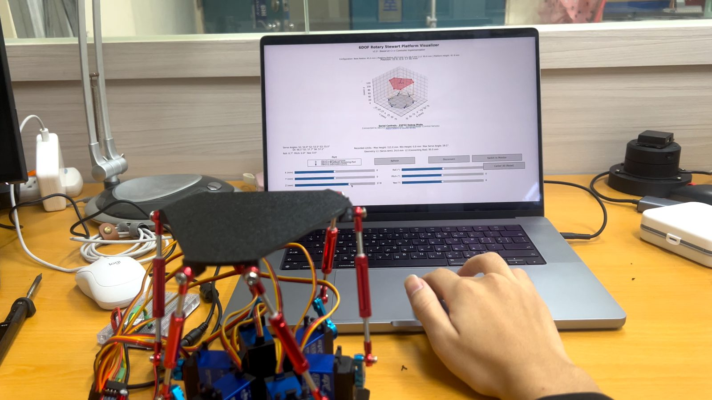
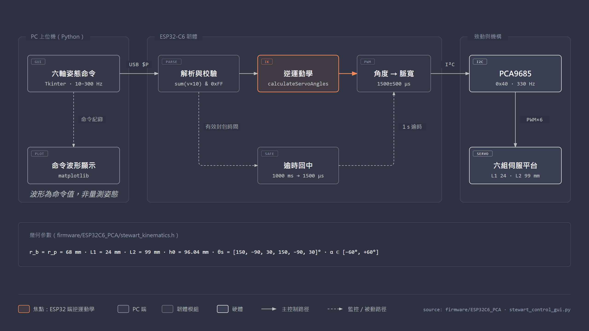
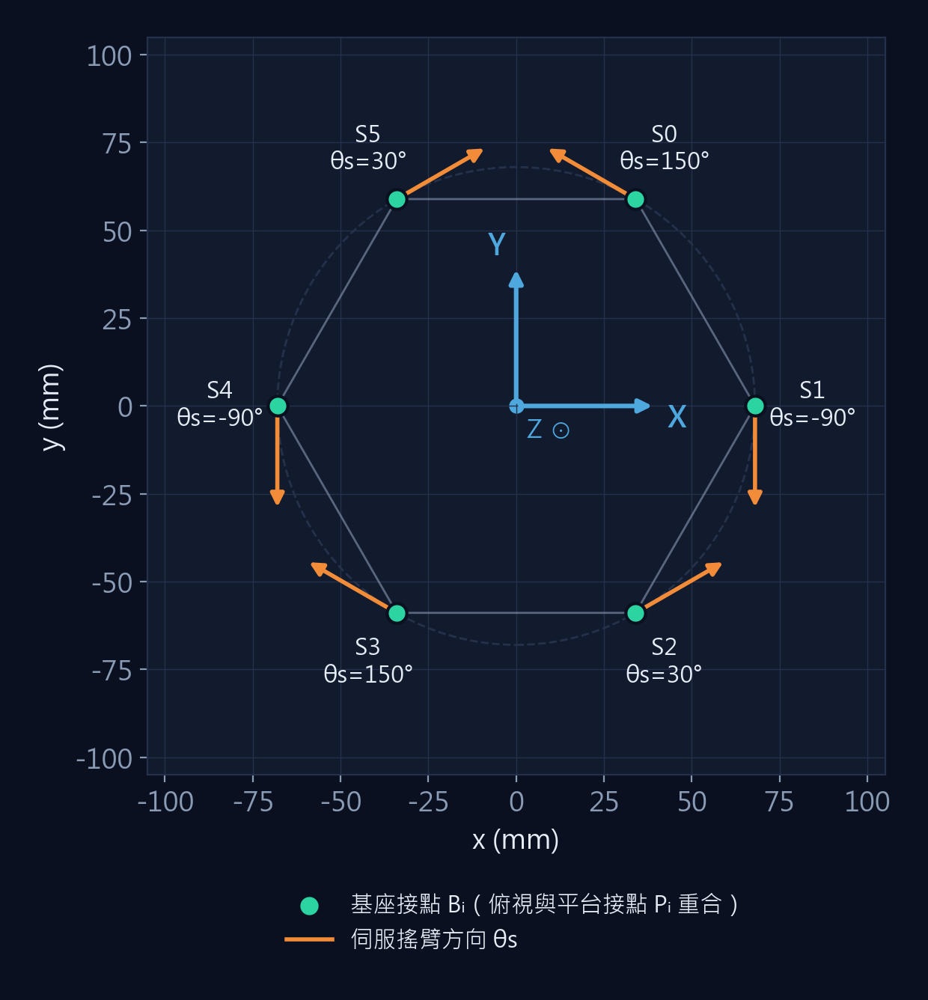
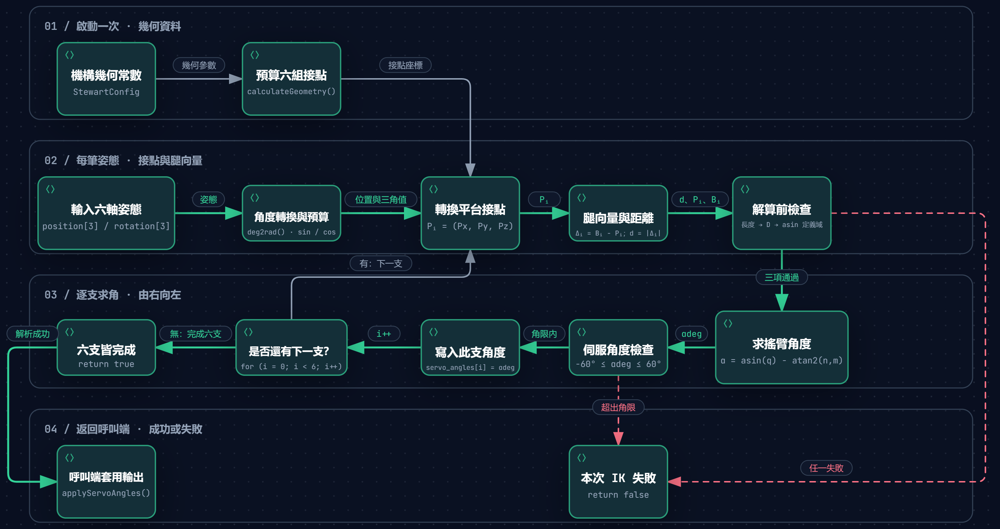
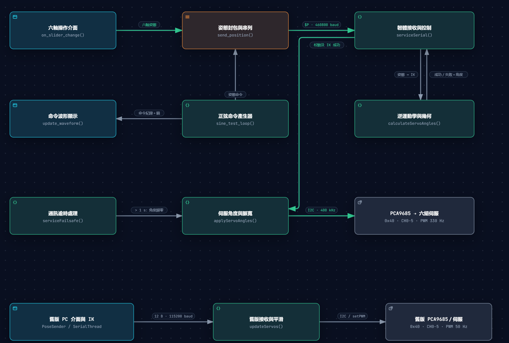
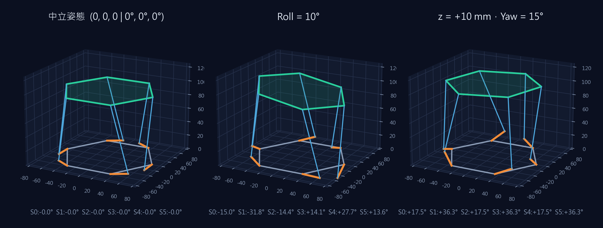
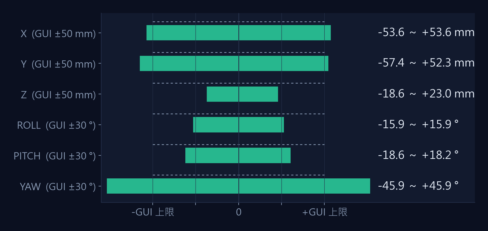
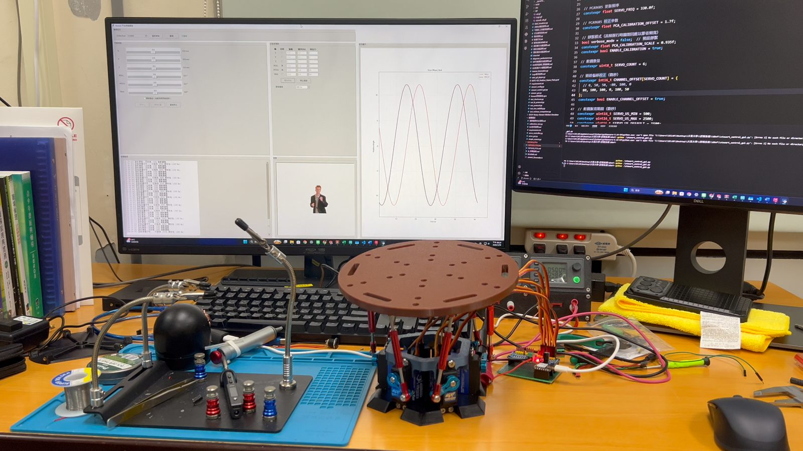
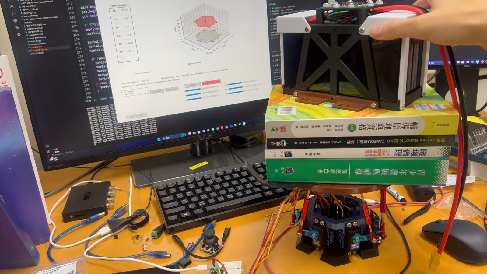

<!-- _class: cover -->
<!-- _paginate: false -->
<!-- _footer: '' -->

<div class="wrap">
<div class="eyebrow">6-DOF PARALLEL MANIPULATOR</div>

# Mini Stewart Platform

<div class="sub">小型六自由度並聯平台<br>ESP32-C6 板上逆運動學 × Python 上位機</div>

<div class="meta">
<b>報告人</b>　ZHANG-XICHANG<br>
<b>單位 / 指導教授</b>　<span class="tbd">待補</span><br>
<b>專案</b>　github.com/ZHANG-XICHANG/Mini-Stewart-Platform
</div>
</div>

---

# <span class="num">01</span>研究動機與設計目標

## 把全尺寸動態模擬平台縮小，並讓控制器自己完成運動學解算

<div class="cols">
<div>

### 動機

- Stewart 平台以六支並聯腿決定上平台的六軸位姿，常見於動態模擬器與定位平台
- 本專案基於開源專案 **knaufinator / 6DOF-Rotary-Stewart-Motion-Simulator**（旋轉式致動）
- 原設計為全尺寸機構；目標是做出**可在桌面驗證演算法**的小型版本

<div class="kpi" style="margin-top:22px">
<div><b>2 代</b><span>實機迭代</span></div>
<div><b>6 DOF</b><span>x y z ／ roll pitch yaw</span></div>
<div><b>ESP32-C6</b><span>板上逆運動學</span></div>
</div>

</div>
<div>

### 設計目標

<div class="card accent small">

1. **機構小型化**：重新設計並開放 STL / STEP / SolidWorks 檔
2. **板上逆運動學**：ESP32-C6 接收姿態、自行求解六軸角度
3. **上位機**：六軸手動操作、各軸正弦測試、命令波形顯示
4. **安全機制**：封包校驗、角度限制、通訊逾時回中位

</div>
<div class="frame" style="margin-top:14px"></div>
<div class="caption">初代平台與舊版 3D 視覺化上位機</div>
</div>
</div>

---

# <span class="num">02</span>六自由度並聯機構原理

## 六條「旋轉搖臂＋連桿」閉鏈共同決定上平台位姿

<div class="cols-46">
<div>

- **輸入**：上平台位姿 $\mathbf{q}=[x,y,z,\phi_r,\phi_p,\psi]$，三平移、三旋轉
- **每條腿**：伺服搖臂 $L_1$ 旋轉 → 球頭連桿 $L_2$ 連到上平台接點
- **並聯閉鏈**：六腿同時承載，任一腿角度改變都會影響整體位姿
- **逆運動學**有逐腿封閉解：已知位姿 → 直接算出六個伺服角
- 正運動學（角度 → 位姿）需數值求解，本專案**未實作**

<div class="kpi">
<div><b>6</b><span>伺服致動器</span></div>
<div><b>24 mm</b><span>搖臂 L₁</span></div>
<div><b>99 mm</b><span>連桿 L₂</span></div>
</div>

</div>
<div>
<div class="frame" style="background:#e9ebee"></div>
<div class="caption">二代 SolidWorks 組合件（models/solidworks/組合件1.SLDASM）</div>
</div>
</div>

---

# <span class="num">03</span>系統整體架構

## PC 只送姿態；解算、映射與安全邏輯都在 ESP32-C6

<div class="center"></div>

<div class="caption">來源：firmware/ESP32C6_PCA、stewart_control_gui.py ｜ 實線為主控制路徑，虛線為監控／逾時路徑</div>

---

# <span class="num">04</span>機構與硬體設計

## 兩代實機迭代，幾何參數與韌體常數一致

<div class="cols">
<div>

<div class="cols" style="gap:12px">
<div><div class="frame"></div><div class="caption">初代：五邊形平台、外露杜邦線</div></div>
<div><div class="frame"></div><div class="caption">二代：圓形平台、控制盒整合</div></div>
</div>

<div class="small" style="margin-top:14px">

**CAD 零件**：大平台、平台、底座、控制盒、搖臂、球頭、緊箍、連桿、舵機 ｜ **可列印 STL**：大平台、底座、控制盒、緊箍

</div>
</div>
<div>

| 項目 | 設定（程式常數） |
| --- | --- |
| 底座 / 平台半徑 | 68 / 68 mm |
| 搖臂 L₁ / 連桿 L₂ | 24 / 99 mm |
| 中立高度 h₀ | 96.04 mm |
| 控制器 | ESP32-C6，I²C 400 kHz（GPIO22/23） |
| PWM 驅動 | PCA9685 `0x40`，CH0–CH5，330 Hz |
| 脈寬範圍 | 500–2500 µs，中位 1500 µs |
| 伺服型號 / 電源規格 | <span class="tbd">待補</span> |

</div>
</div>

---

# <span class="num">05</span>座標系統與姿態定義

## 原點在底座中心，z 軸向上；旋轉單位為度

<div class="cols-46">
<div>

</div>
<div>

**姿態向量**（平移 mm、旋轉 °）

$$\mathbf{q}=[\,x,\;y,\;z,\;\text{roll},\;\text{pitch},\;\text{yaw}\,]$$

**旋轉矩陣**（本實作 roll 繞 Y、pitch 繞 X）

$$R = R_z(\text{yaw})\,R_y(\text{roll})\,R_x(\text{pitch})$$

**平台中心** $\;T=[\,x,\;y,\;h_0+z\,]$

<div class="card small">

中立高度 $h_0 = 96.04$ mm 與 $\sqrt{L_2^2-L_1^2}=96.05$ mm 一致：中立時搖臂近乎水平，計算得 $\alpha_i \approx -0.016^\circ$

</div>
</div>
</div>

---

# <span class="num">06</span>逆運動學數學模型

## 逐腿封閉解：位姿 → 六個伺服角 $\alpha_i$（`calculateServoAngles()`）

<div class="cols">
<div>

**① 平台接點轉換**
$$P_i = R\,p_i + T,\qquad d_i=\lVert B_i - P_i\rVert$$

**② 方程係數**
$$\ell_i = d_i^2-(L_2^2-L_1^2),\qquad m_i = 2L_1 P_{i,z}$$
$$n_i = 2L_1\big[\cos\theta_{s,i}(P_{i,x}-B_{i,x})+\sin\theta_{s,i}(P_{i,y}-B_{i,y})\big]$$

**③ 伺服角**
$$\alpha_i=\arcsin\!\frac{\ell_i}{\sqrt{m_i^2+n_i^2}}-\operatorname{atan2}(n_i,\,m_i)$$

</div>
<div>

### 解算前後的三項檢查

<div class="card warn small">

1. 長度可達：$\lvert d_i-L_1\rvert \le L_2$
2. 定義域：$\lvert \ell_i \rvert/\sqrt{m_i^2+n_i^2}\le 1$
3. 角度限制：$-60^\circ \le \alpha_i \le 60^\circ$

任一腿失敗 → 整筆姿態不套用，`ikFailCount` 累加

</div>

<div class="small muted" style="margin-top:14px">

$B_i$：基座接點（z = 0）｜$p_i$：平台局部接點｜$\theta_{s,i}$：伺服搖臂方向 [150, −90, 30, 150, −90, 30]°<br>
推導參考 R. Eisele (2019), *Inverse Kinematics of a Stewart Platform*

</div>
</div>
</div>

---

# <span class="num">07</span>六軸致動器控制流程

## 從角度到 PCA9685 計數值，每一步都在韌體內

<div class="cols" style="grid-template-columns:2.6fr 1fr;gap:20px">
<div class="frame"></div>
<div class="small">
<div class="card" style="margin-bottom:10px;padding:10px 14px"><b>① 反轉與映射</b><br>CH0/2/4 取負號<br><code>µs = 1500 + α/60·500</code><br>夾在 500–2500 µs</div>
<div class="card" style="margin-bottom:10px;padding:10px 14px"><b>② 逐通道校正</b><br>偏移 80,100,100,0,100,50 µs<br><code>(µs+1.7)/0.935</code></div>
<div class="card" style="padding:10px 14px"><b>③ 輸出 PCA9685</b><br><code>µs·4096/(10⁶/330)</code><br><code>setPWM(ch,0,count)</code></div>
</div>
</div>
<div class="caption">Archify 流程圖：calculateServoAngles() 逐支求角，任一支失敗即整筆不套用</div>

---

# <span class="num">08</span>軟體架構與資料流

## 上位機產生命令，韌體負責驗證、解算與安全回中

<div class="cols-64">
<div class="frame"></div>
<div class="small">

**通訊封包**（ASCII，換行結尾，460800 baud）

```text
$P,x,y,z,roll,pitch,yaw,checksum
```

- checksum ＝ Σ int(值×10) 取低 8 位
- 手動滑桿：實時送出最小間隔 **50 ms**
- 正弦測試：更新頻率 **10–300 Hz** 可選
- 波形顯示每 **100 ms** 重繪（命令值）
- 封包組裝逾時 100 ms；**1 s** 無有效姿態 → 回中位
- `$V,0 / $V,1` 切換詳細回應

</div>
</div>

---

# <span class="num">09</span>運動模擬與實體測試

## 以韌體同一套 IK 進行 3D 模擬，再對照實機運行

<div class="center"></div>

<div class="cols" style="gap:24px;margin-top:6px">
<div class="small">

**模擬自檢**：三種姿態下，以解出的 $\alpha_i$ 重建搖臂端點，連桿長度與 99 mm 的誤差 < 10⁻¹³ mm<br>
<span class="muted">模擬為 Python 移植之韌體公式（presentations/assets/figures.py），非量測值</span>

</div>
<div class="small">

**實體測試紀錄**：初代與二代運行影片、負載測試照片<br>
▶ [二代運行影片](https://github.com/ZHANG-XICHANG/Mini-Stewart-Platform/blob/main/docs/videos/v2-demo.mp4)　▶ [初代運行影片](https://github.com/ZHANG-XICHANG/Mini-Stewart-Platform/blob/main/docs/videos/v1-demo.mp4)

</div>
</div>

---

# <span class="num">10</span>實驗結果與性能分析

## 理論工作範圍已可計算；硬體定量數據仍待量測

<div class="cols-64">
<div>

<div class="caption">由中立姿態單軸掃描（步距 0.05），IK 三項檢查皆通過的範圍｜虛線為 GUI 滑桿上限</div>
</div>
<div class="small">

**模擬發現**：z、roll、pitch 的可達範圍小於 GUI 滑桿上限，超出時韌體回報 IK 失敗、不動作

| 指標 | 結果 |
| --- | --- |
| 實機運行（兩代） | <span class="ok">已完成</span> |
| 重複定位精度 | <span class="tbd">待補</span> |
| 最大負載 | <span class="tbd">待補</span> |
| 正弦追蹤誤差 / 頻寬 | <span class="tbd">待補</span> |
| 實際封包率 | <span class="tbd">待補</span> |

<span class="muted">韌體已內建 `[ESP32-PERF]` 每 5 s 統計封包率與 IK 失敗數，可作為量測起點</span>

</div>
</div>

---

# <span class="num">11</span>開發過程中的技術挑戰

## 數學正確性、硬體差異與協定相容

<div class="cols">
<div class="card warn small">

### 旋轉矩陣錯誤（已修正）

沿用的展開式第二列把 `cos(roll)` 與 `cos(pitch)` 對調，矩陣**不正交**。改為標準 $R_z R_y R_x$（commit `2376aef`）。

| 單軸傾斜 | 5° | 10° | 15° |
| --- | --- | --- | --- |
| 伺服角最大差 | 0.07° | 0.30° | 0.72° |

<span class="muted">中立、平移與純 yaw 不受影響；修正後韌體 <span class="tbd">待重新燒錄實測</span></span>

</div>
<div class="small">

<div class="card" style="margin-bottom:12px">

**伺服個體差異** → 逐通道偏移 ＋ PCA 輸出校正（scale 0.935）；數值只適用原實機

</div>
<div class="card" style="margin-bottom:12px">

**兩套協定並存** → 主版 `$P` 姿態 460800 baud；舊版 12-byte 角度 115200 baud，分目錄隔離

</div>
<div class="card">

**浮點校驗邊界** → 韌體單精度、上位機雙精度，`int(v×10)` 截斷在小數邊界可能不一致 <span class="tbd">待實測</span>

</div>
</div>
</div>

---

# <span class="num">12</span>改善方案與研究延伸

## 從開迴路命令走向可量測、可驗證的閉迴路平台

<div class="cols-3">
<div class="card accent">

### 量測與驗證

- 上平台加 IMU，量測實際姿態
- 建立重複定位、負載、頻率響應測試流程
- 以 `[ESP32-PERF]` 記錄封包率與 IK 失敗率

</div>
<div class="card accent">

### 控制與安全

- GUI 依模擬工作空間限制輸入
- 速度 / 加速度限制與軌跡平滑
- 硬體急停：切斷伺服電源
- checksum 改為定點整數或 CRC-8

</div>
<div class="card accent">

### 研究延伸

- 數值正運動學（Newton–Raphson）
- 姿態閉迴路控制（PID / LQR）
- 應用：球平衡、相機穩定、動態模擬

</div>
</div>

<div class="kpi small" style="margin-top:20px">
<div><b>短期</b><span>重新燒錄並實測旋轉修正、GUI 範圍限制、checksum 定點化</span></div>
<div><b>中期</b><span>IMU 量測與定量測試：精度、負載、頻率響應</span></div>
<div><b>長期</b><span>姿態閉迴路控制與應用驗證</span></div>
</div>

<div class="caption" style="margin-top:12px">以上為規劃方向，尚未實作</div>

---

<!-- _class: closing -->

# <span class="num">13</span>結論與成果展示

<div class="cols-46">
<div>

- 完成**小型化 Stewart 平台**兩代實機與開源 CAD
- 逆運動學移至 **ESP32-C6**，PC 只送六軸姿態
- 上位機支援手動、正弦測試與命令波形
- 找出並修正**旋轉矩陣不正交**的錯誤
- 以模擬算出單軸工作範圍，定位 GUI 與機構的落差

<div class="small" style="margin-top:18px">

🌐 [專案網站](https://zhang-xichang.github.io/Mini-Stewart-Platform/)　💻 [GitHub](https://github.com/ZHANG-XICHANG/Mini-Stewart-Platform)

</div>

<div class="kpi" style="margin-top:22px">
<div><b>2 代</b><span>實機迭代</span></div>
<div><b>3 項</b><span>IK 安全檢查</span></div>
<div><b>0.72°</b><span>15° 傾斜時修正前誤差</span></div>
</div>
</div>
<div>
<div class="frame"></div>
<div class="caption">二代平台運行中，後方為上位機正弦命令波形</div>
<div class="frame" style="margin-top:8px"></div>
<div class="caption">負載測試情境（重量與時間 <span class="tbd">待補</span>）</div>
</div>
</div>

---

# 參考資料與致謝

<div>

1. knaufinator, *6DOF-Rotary-Stewart-Motion-Simulator*, GitHub — 本專案的原始設計基礎（MIT License，保留 Chris Knauf 署名）
2. R. Eisele, *Inverse Kinematics of a Stewart Platform*, raw.org, 2019 — 逆運動學推導
3. D. Stewart, "A Platform with Six Degrees of Freedom," *Proc. Inst. Mech. Eng.*, vol. 180, 1965

**AI 協作說明**：OpenAI Codex 協助文件與程式檢查；Claude Code 協助建立展示網站、架構圖、本簡報圖表，並找出旋轉矩陣錯誤。機構縮小、硬體組裝與實機測試由作者完成；照片與影片為實際紀錄。

</div>

<div class="center" style="margin-top:48px;font-size:34px;font-weight:700">謝謝聆聽　Q &amp; A</div>
